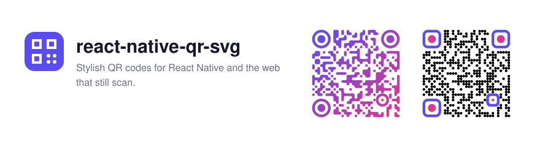
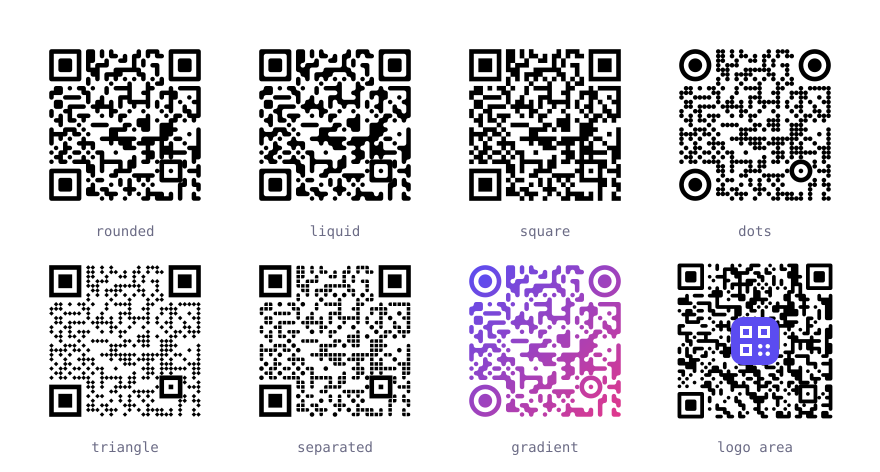

  <a href="https://exzos28.github.io/react-native-qr-svg/">
    <picture>
      <source media="(prefers-color-scheme: dark)" srcset="images/banner-dark.svg">
      
    </picture>
  </a>

  

    
    
    
    
  

  

    <a href="https://exzos28.github.io/react-native-qr-svg/docs/intro"><b>Documentation</b></a> ·
    <a href="https://exzos28.github.io/react-native-qr-svg/docs/playground"><b>Playground</b></a> ·
    <a href="https://exzos28.github.io/react-native-qr-svg/docs/api"><b>API</b></a>
  

QR codes for React Native and the web, drawn with react-native-svg. Style them freely without giving up the one thing a QR code must do: scan.

- **Seamless shapes.** `rounded`, `liquid`, `square`, `dots` and `triangle`. Connected modules are traced as one outline: no hairline seams, half the path data.
- **Custom eyes and colors.** Square, rounded or circle finder patterns in their own colors, gradients, gaps, quiet zone and logos.
- **Scannable by default.** A test suite decodes every built-in style with a real QR decoder. The defaults keep finder patterns solid and raise error correction for logos, and development warnings catch logos or styles that may not scan.
- **Lightweight.** Pure JavaScript with one small dependency: works in Expo Go and on the web.
- **Not only React.** The same code renders to an SVG string for servers, sharing or saving to a file.

  <picture>
    <source media="(prefers-color-scheme: dark)" srcset="images/showcase-dark.svg">
    
  </picture>
   
  Real, scannable codes rendered by the library. <a href="https://exzos28.github.io/react-native-qr-svg/docs/playground">Try every option →</a>

## Getting started

Install it in a bare React Native app or with Expo by following [Installation](https://exzos28.github.io/react-native-qr-svg/docs/installation), then style your first code in the [Playground](https://exzos28.github.io/react-native-qr-svg/docs/playground), which shows the props for every option you pick.

## Documentation

| | |
| --- | --- |
| [Styling](https://exzos28.github.io/react-native-qr-svg/docs/guides/styling) | Shapes, gaps, eyes, colors and gradients, size and quiet zone |
| [Logos](https://exzos28.github.io/react-native-qr-svg/docs/guides/logos) | Logos that still scan, and how big they can be |
| [Scannability](https://exzos28.github.io/react-native-qr-svg/docs/guides/scanning) | What the scan tests check and what the defaults do for you |
| [SVG without React](https://exzos28.github.io/react-native-qr-svg/docs/guides/svg-string) | `qrCodeToSvgString` and `encodeQr` for servers, sharing and other renderers |
| [Custom renderer](https://exzos28.github.io/react-native-qr-svg/docs/guides/custom-renderer) | Draw every module yourself |
| [Migrating to 2.1](https://exzos28.github.io/react-native-qr-svg/docs/migration) · [Troubleshooting](https://exzos28.github.io/react-native-qr-svg/docs/troubleshooting) | |
| [API reference](https://exzos28.github.io/react-native-qr-svg/docs/api) | Every prop and function |

## Example apps

[`apps/rn-cli-example`](apps/rn-cli-example) (bare React Native) and [`apps/expo-example`](apps/expo-example) (Expo Go, development build and web) show the same interactive demo. See [CONTRIBUTING.md](CONTRIBUTING.md) to run them.

## Contributing

Issues and pull requests are welcome. [CONTRIBUTING.md](CONTRIBUTING.md) covers the monorepo, tests and releases.

## License

[MIT](LICENSE)
